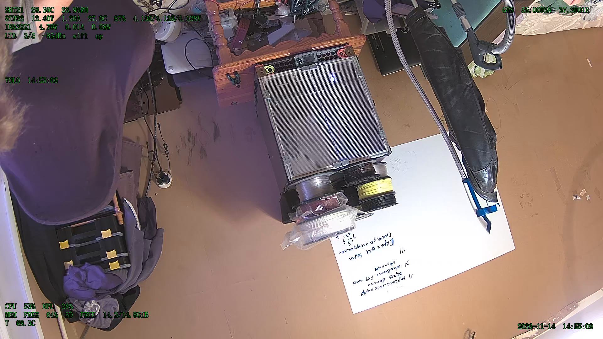
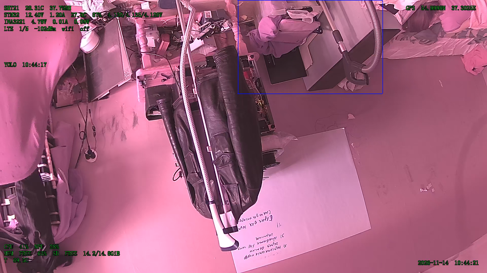
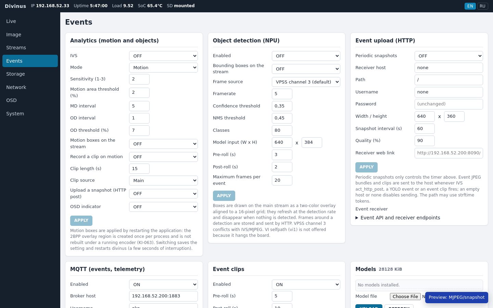
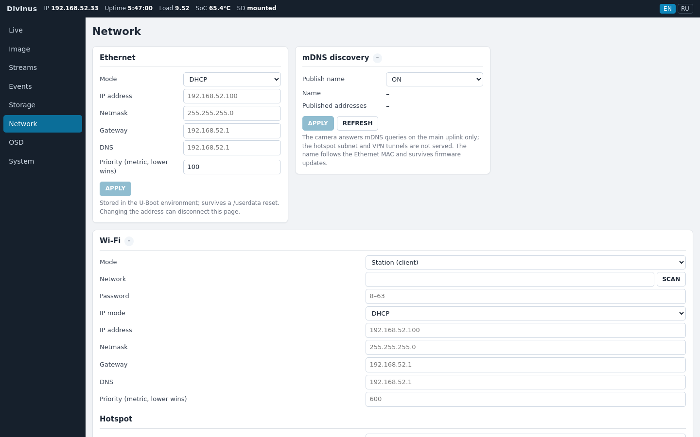
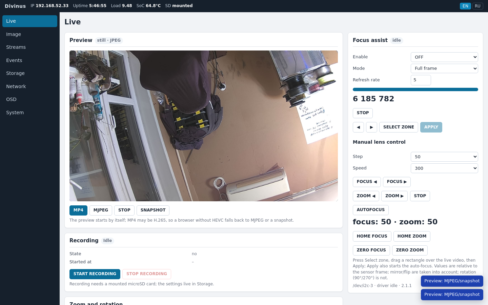
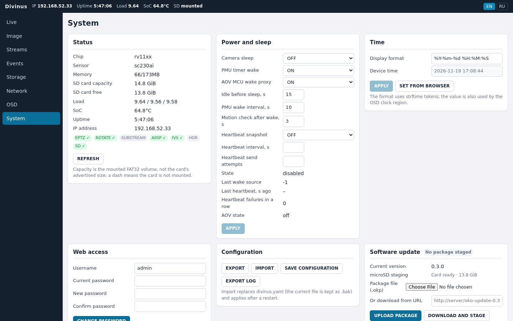
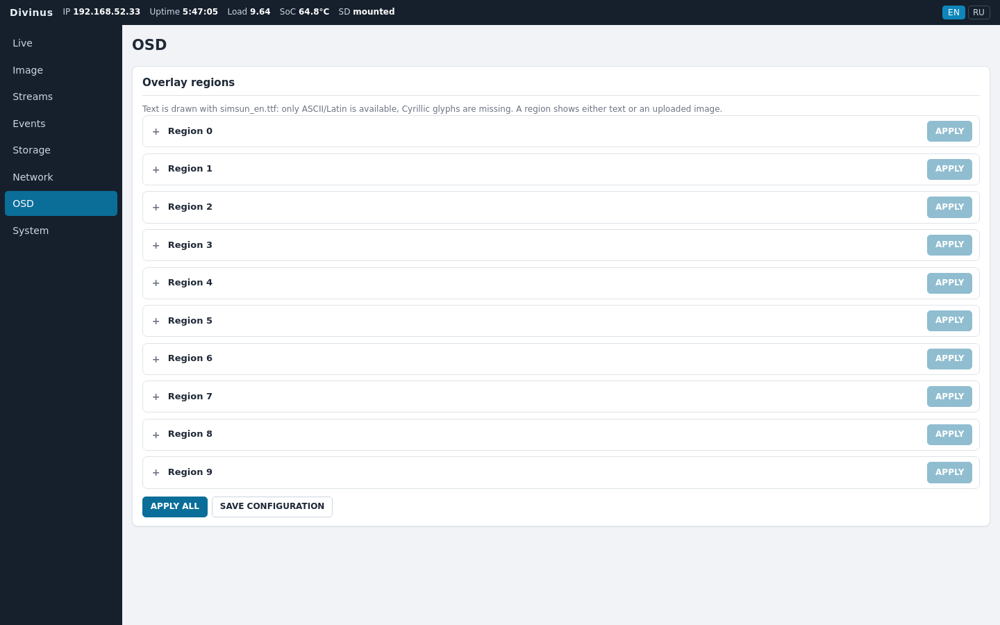
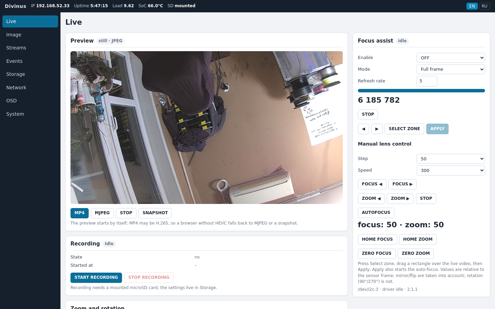
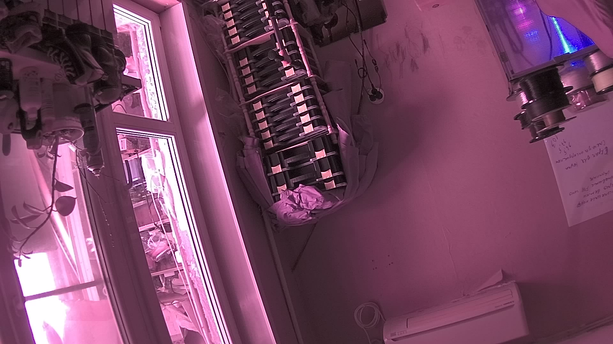

# Презентация OKO — слайды

Версия продукта: **0.4.0**. Статус материалов: **2026-11-20**. Основа —
`FEATURES_VERIFIED.md`, `FEATURES.md`, `VERIFIED_FUNCTIONS.md`, `TO_DO.md` и
`README_RU.md`. Снимки стенда: 2026-11-08…18. Формулировки «экспериментально»
означают работу на стенде, а не продуктовый профиль.

## Слайд 1. OKO — автономная IPC-камера на Rockchip RV1106
**Сообщение:** Компактная камера объединяет видео, бортовую аналитику и управление устройством.
- **Преимущество:** меньше внешних компонентов и проще развертывание автономной видеоточки.
- Luckfox Pico Pro Max, RV1106, сенсор SC230AI.
- SPI NAND, Buildroot, автономная загрузка.
- Версия 0.4.0.
**Цифра/доказательство:** 1080p30 и 480p120 — `FEATURES.md:23–27`.
**Визуал:** Титульный кадр камеры и схема «сенсор → RV1106 → сеть».

## Слайд 2. Что это и зачем
**Сообщение:** Видеонаблюдение, события, AI и обслуживание работают на одном устройстве.
- **Преимущество:** один корпус закрывает основные задачи наблюдения и снижает сложность интеграции.
- Видео и события обрабатываются локально.
- AI работает на встроенном NPU.
- Телеметрия доступна в WebUI и MQTT.
- WebUI объединяет настройку и диагностику.
**Цифра/доказательство:** Восемь разделов WebUI и девять плиток телеметрии — `FEATURES_VERIFIED.md:50,57`.
**Визуал:** Схема «видео — AI — телеметрия — управление».

## Слайд 3. Платформа для автономной работы
**Сообщение:** Продуктовый образ рассчитан на компактную SPI NAND и самостоятельную загрузку.
- **Преимущество:** камера может запускаться без отдельного компьютера и сохраняет предсказуемый состав прошивки.
- RV1106 объединяет CPU, NPU и ISP.
- Linux 5.10.160 и Buildroot.
- `boot` 6 МБ, `oem` 40 МБ, `userdata` 40 МБ, `rootfs` 168 МБ.
- Сборка нативно на Debian 13.
**Цифра/доказательство:** Разметка и сборка образа — `FEATURES_VERIFIED.md:16,21`.
**Визуал:** Полоса разметки NAND.

## Слайд 4. Видео для разных сценариев
**Сообщение:** Основной поток, предпросмотр и браузерные форматы доступны одновременно.
- **Преимущество:** один источник видео подходит для оператора, архива и разных клиентских приложений.
- RTSP H.265 1920×1080 при 30 fps, второй поток 640×360.
- MJPEG для браузеров без HEVC.
- ePTZ 1×/2×/4× и поворот 0/90/180/270°.
- AIISP поддерживает ночной видеосценарий.
**Цифра/доказательство:** Основной поток около 4,7 Мбит/с — `FEATURES_VERIFIED.md:24–35`.

## Слайд 5. AI-аналитика на борту
**Сообщение:** Детекция объектов выполняется на NPU без передачи видеопотока во внешний сервис.
- **Преимущество:** уменьшается объём сетевого трафика, а базовая аналитика продолжает работать локально.
- YOLOv5n и YOLO11n поддерживаются на NPU.
- Рамки детекций видны в основном потоке.
- Движение и события доступны через API и WebUI.
- Стек рантайма 2.5.0 и экспериментальный live-режим рамок — слайд 12.
**Цифра/доказательство:** YOLOv5n — 17%, YOLO11n — 28% NPU при 5 fps — `FEATURES_VERIFIED.md:36`.

## Слайд 6. Событие превращается в доказательство
**Сообщение:** Контекст события сохраняется и доставляется в системы верхнего уровня.
- **Преимущество:** система получает не только сигнал тревоги, но и материалы для проверки и автоматической реакции.
- Ролик pre/post в fMP4 и пачка JPEG-кадров.
- HTTP POST для кадров и роликов.
- MQTT 3.1.1 для событий, телеметрии и статуса.
**Цифра/доказательство:** 1355 доставленных событий, 0 потерянных за двухчасовой soak — `FEATURES_VERIFIED.md:37–38`.

## Слайд 7. Связь без привязки к одному каналу
**Сообщение:** Камера продолжает работу при смене доступного сетевого пути.
- **Преимущество:** повышается доступность камеры при отказе кабельного или беспроводного канала.
- Ethernet и Wi‑Fi STA — равноправные uplink-каналы.
- Автоматический failover по доступности шлюза.
- SoftAP для первичной настройки, mDNS для поиска.
- WireGuard, AmneziaWG и OpenVPN доступны из коробки; AmneziaWG — экспериментальный профиль.
**Цифра/доказательство:** Переключение uplink не более чем за 30 с; 20-минутный soak — `FEATURES_VERIFIED.md:64–68`.

## Слайд 8. Управление для оператора
**Сообщение:** Настройки и диагностика собраны в WebUI и HTTP API.
- **Преимущество:** оператор и интегратор используют единый интерфейс вместо набора разрозненных инструментов.
- Live, Image, Streams, Events, Storage, Network, OSD, System.
- Русский и английский интерфейс, мобильная раскладка.
- Экспорт и импорт конфигурации с откатом битого файла.
**Цифра/доказательство:** API — 103 проверки без ошибок; headless WebUI — `FEATURES_VERIFIED.md:50–56`, `VERIFIED_FUNCTIONS.md:45–47`.

## Слайд 9. Обновление без разборки устройства
**Сообщение:** Жизненный цикл прошивки управляется из WebUI.
- **Преимущество:** обслуживание и обновление можно выполнять удалённо, без разборки камеры.
- OTA-пакет `.okp` проверяется по sha256 и размерам.
- U-Boot обновляет `boot`, `oem` и `rootfs` с microSD.
- Прошивки STM8 и STM32 запускаются через WebUI.
**Цифра/доказательство:** Полный OTA-цикл: 61,8 МБ, три раздела, `postcheck ok=1` — `FEATURES_VERIFIED.md:43–46`.

## Слайд 10. Питание и телеметрия
**Сообщение:** Состояние камеры и питания видно рядом с видео.
- **Преимущество:** оператор быстрее понимает причину сбоя и может контролировать ресурс автономной системы.
- `oko-ec` собирает напряжение, ток, SOC, температуру и влажность.
- Значения выводятся в OSD и MQTT.
- Heartbeat оставлен одной строкой: подробности и оговорки — на слайде 12.
**Цифра/доказательство:** Девять плиток телеметрии обновляются с возрастом 1–2 с — `FEATURES_VERIFIED.md:57,69–70`.

## Слайд 11. Фокус как часть продукта
**Сообщение:** Контроль резкости, моторизованный объектив и обновление контроллеров объединены в одном интерфейсе.
- **Преимущество:** настройка оптики и обслуживание приводов включены в общий рабочий процесс камеры.
- AF-карта и ROI для помощи фокусировке.
- STM8 управляет объективом по I2C.
- Доступны движение, остановка, позиция, home и zero.
- STM8/STM32 обновляются через WebUI.
**Цифра/доказательство:** AF-карта 225 ячеек; позиция 5002→5012→5002 — `FEATURES_VERIFIED.md:41–45`.

## Слайд 12. Экспериментальные — уже работают
**Сообщение:** На стенде работают шесть дополнительных направлений; они не входят в продуктовый профиль.
- **Преимущество:** экспериментальный контур показывает варианты дальнейшего снижения энергопотребления, нагрузки CPU и зависимости от инфраструктуры.
1. **Сон камеры с heartbeat-кадром:** 200 heartbeat за 61,8 мин; сеть после resume готова не сразу, длинный тихий сон на AP — NO-GO (KI-071/KI-072).
2. **YOLO11n RKOPT на RKNN 2.5.0:** `yolo.runtime: 2`, NPU 28% при 5 fps, CPU около 12%; mAP не измерялся.
3. **RGA NV12→RGB888 по fd:** CPU около 35,6% → 29,4% при 5 fps; двухчасовой soak без зависаний.
4. **Рамки детекции:** `yolo.boxes` (RGN 12) и `ivs.boxes` (RGN 13); live-режим opt-in и не полностью проверен.
5. **UDP/RTP-раздача:** H.265 PT 96, MediaMTX; расхождение fps 0,1%, задержка 1–7 мс.
6. **NAND ↔ NFS-boot через env U-Boot:** 10/10 циклов, два холодных старта.
7. **AmneziaWG:** AWG v3.1, loopback-handshake и split-маршрут; внешний пир ещё не проверялся.
**Источники:** `FEATURES_UNVERIFIED.md:17–41`, `FEATURES_VERIFIED.md:22,26,31,36,76`, `VERIFIED_FUNCTIONS.md:85,92,94`.

## Слайд 13. Доказательность вместо обещаний
**Сообщение:** Статус «работает» привязан к воспроизводимому стендовому прогону.
- **Преимущество:** деловые решения принимаются по измерениям и ограничениям, а не только по декларации возможностей.
- API проверяется автоматизированной матрицей.
- WebUI — headless Chromium на desktop и mobile.
- Потоки, события и heartbeat проверяются soak-тестами.
- Даты, артефакты и ограничения собраны в реестре.
**Цифра/доказательство:** Реестр доказательств — `VERIFIED_FUNCTIONS.md:7–17,85–95`.
**Визуал:** «Функция → тест → артефакт → запись».

## Слайд 14. Роадмап
**Сообщение:** Следующий этап усиливает качество аналитики, энергоэффективность и варианты транспорта.
- **Преимущество:** развитие направлено на измеримое повышение точности, автономности и гибкости подключения.
- Проверить сходимость AF на реальном объективе.
- Измерить mAP и ночную точность моделей.
- Разработать MCU-frame heartbeat v2.
- Перенести полезные механизмы быстрого старта по плану P1–P7.
- Завершить проверки добавленных, но неполностью проверенных функций: USB HID,
  USB-сеть, Bluetooth, SDIO Wi‑Fi, физический hotplug microSD, runtime IQ и
  сквозные реальные MQTT-события.
- Исследовать devourer, wfb-ng и SRT.
**Источник:** `TO_DO.md:9–12,411–445,517–525,573–603,605–613`.
**Визуал:** Дорожная карта от версии 0.4.0.
